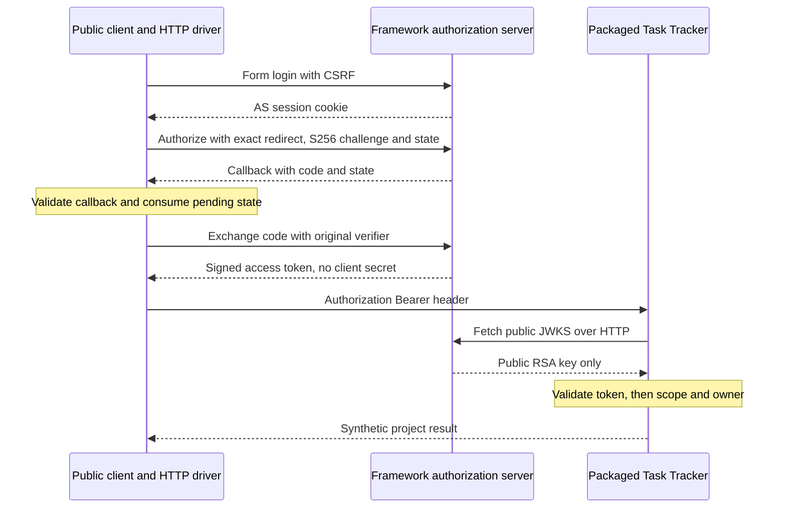

# Actual OAuth authorization code + PKCE → Task Tracker

This lab fills a specific gap: a signed JWT fixture can test a resource server, but it does not demonstrate how a user authorizes a public client to obtain that token. Here **Spring Security's real authorization server** authenticates a synthetic user, issues a one-time authorization code, checks S256 PKCE and returns a signed access token. A client presents it to the **existing packaged Task Tracker**, which fetches the real public JWKS over HTTP and enforces its existing audience, scope and object-owner rules.

No authorization/token/JWKS response is faked. The Python client drives real HTTP, cookies, redirects and form login without a browser UI. It is a small instructional client, not a production OAuth client SDK. The framework implements the authorization-server protocol.

Read [Spring Security](../../content/java-spring/09-spring-security.md) for the broader concepts and [Task Tracker's security guide](../java-spring/task-tracker/SECURITY.md) for its JWT/owner boundary. This package adds the missing interaction rather than a second CRUD app or another security theory chapter.

## 1. Run and identify the roles

Requirements: Java 17+, Maven and Python 3.12+. There are no paid services, Docker requirement, pre-existing identity account or committed credential.

```sh
python3 -m unittest discover -s examples/backend-identity -p 'test_client.py' -v
python3 examples/backend-identity/verify.py
```

The verifier builds this module, copies Task Tracker's source into this module's ignored temporary directory, packages that copy with its existing source unchanged, and starts two owned JAR processes. It never edits/builds into the original Task Tracker directory. Its existing full test suite has its own workflow; this integration build deliberately skips that copied suite and exercises the packaged application through HTTP instead.

`mvn -B -f examples/backend-identity/pom.xml verify` alone runs two configuration guards and packages the authorization server. It does **not** execute the Python HTTP flow. The dedicated [identity workflow](../../.github/workflows/backend-identity.yml) runs both the client guards and the actual verifier, then refuses missing actual-case evidence.

| Role | Concrete process or component | Responsibility |
| --- | --- | --- |
| Resource owner | Generated `learner-…` user | Authenticates and authorizes this pre-approved first-party teaching client |
| Authorization server | Packaged Spring Security server | Login/session, registered client, authorization code, PKCE, token signing, public JWKS |
| Public client | Python transport + one pending transaction | Creates verifier/state, handles the exact callback, exchanges code, uses token |
| User agent | Python cookie/redirect HTTP driver | Simulates the browser transport; does not claim browser/SameSite/XSS evidence |
| Resource server | Unchanged packaged Task Tracker with `jwt` active | Verifies access token, applies scopes and existing project-owner checks |

The AS has one runtime-generated RSA key and in-memory users, registrations, grants and sessions. Three public registrations demonstrate normal tokens, a one-second expiry case and an audience for another teaching API. They have **no client secret**, require PKCE and permit only `authorization_code`; the application additionally requires S256 and an exact registered callback. The client IDs are public identifiers, not credentials.

Restarting this teaching AS loses its in-memory grants/sessions and generates a new signing key; this is not durable identity or an immediate-revocation design. The users and all passwords are generated for each run. Task Tracker's existing Basic users receive separate generated passwords. Its H2 database lives inside the run's private temporary directory. The OS assigns the authorization, resource and callback ports; both applications bind IPv4 loopback.

## 2. Predict → observe the actual exchange



Before running, write down which role should see each value:

1. The public client generates a random **verifier**, keeps it in memory, and sends only `BASE64URL(SHA256(verifier))` as the S256 challenge.
2. It also generates a random **state** tied to its one pending transaction and a 30-second expiry.
3. The driver logs into the AS with actual generated user credentials and a valid login CSRF token. The session cookie is for AS login, not API permission.
4. `/oauth2/authorize` receives client ID, the exact registered redirect, scope, state and challenge. The client is pre-approved for this synthetic first-party exercise; there is no interactive consent screen.
5. The real AS redirects a one-time code and state to the owned callback. The callback checks destination, state, expiry, duplicates and errors before accepting the code. It consumes its pending state once.
6. The client POSTs the accepted code, original verifier, client ID and same redirect to `/oauth2/token`. No password or client secret goes in this exchange.
7. The framework verifies the grant/PKCE and returns an access token with `Cache-Control: no-store`. No refresh token or ID token is requested or returned.
8. The client sends `Authorization: Bearer …` to Task Tracker. Task Tracker fetches the AS's actual public JWKS, verifies the token and creates/reads a project through actual JPA persistence.

Predict why an intercepted code is insufficient without the verifier, and why a stolen **access token** is a different problem: PKCE protects code redemption, not bearer-token use after issuance.

The tokens, verifier, state, passwords and private signing key are never printed in success evidence or written to browser storage. The Python process holds temporary client values in memory; the AS holds its protocol state in memory. These are transient teaching processes, not a durable identity deployment.

## 3. Deliberately break one boundary at a time

The verifier runs these real HTTP experiments. Each assertion must pass before the combined success report is published.

| Change or attack | Expected observation | Where to diagnose |
| --- | --- | --- |
| Unauthenticated authorization/API request | Login redirect / API 401 | AS session and resource authentication gates |
| Wrong login password | Login error redirect | AS authentication; no token issued |
| Login POST without CSRF | 403 | Session/form-login CSRF boundary |
| Correct S256 flow | Code → token → project create/read succeeds | All three roles, then actual database |
| Reuse the same authorization code | `invalid_grant` | Framework grant lifecycle; code is single use |
| Replay callback / missing or changed state | Client callback rejects; no exchange | Pending client transaction, before token endpoint |
| Wrong code verifier | Framework returns `invalid_grant` | Token endpoint PKCE validation |
| Changed callback path, query or port | Authorization rejected; no code redirect | Registration and explicit exact-match policy |
| Plain/missing challenge or unregistered `openid` scope | Authorization rejected | S256-only policy / registered scopes |
| Read-only issued scope tries to create | 403 | Resource authorization, not signature verification |
| Second real subject reads first subject's project | 404 | Existing object-owner query boundary |
| Valid issued token for another API audience | 401 | Resource audience validation |
| Modified signature or malformed token | 401 | Bearer parsing/signature validation |
| Actually expired one-second token, after resource skew | 401 | Resource time validation |
| Host header rebinding | 400 | AS loopback host boundary before protocol processing |
| Forwarded-host/proto headers | Issuer remains the actual loopback origin | Forwarded headers are not trusted |
| Existing Basic write without/with CSRF | 403 / 201 | Original Task Tracker boundary remains active |

The JWKS check additionally verifies actual public-key delivery without RSA private fields. Task Tracker uses its existing bounded loopback JWKS implementation and five seconds of timestamp skew; the expiry exercise waits past the token's actual expiry plus that skew, with a bounded wait. Decoding `exp` in the client only chooses that wait; **decoding a payload is not signature validation**. The resource's HTTP rejection is the validation evidence.

### Change exercise

Choose **one** modification, predict the failure, then restore it:

- Replace the client's S256 challenge with the verifier itself while keeping `code_challenge_method=S256`. Authorization may issue a code, but redemption should fail because the calculated challenge differs.
- Remove the client's state comparison. The guard and tampered-callback tests should fail. Do not treat a successful token response as proof that client state handling is correct.
- Change the resource audience configuration to `different-api`. Normal AS tokens should now fail at the API despite correct signatures.
- Request only `projects:read`. Reading an owned project should work while creating one remains forbidden.

Do not weaken the original Task Tracker code or copy a test-generated token into application source to make a failing case pass.

### Debug exercise

Use the first failed boundary to narrow the investigation:

1. **Cannot log in:** check generated runtime settings, the AS cookie jar and login CSRF; do not put the user's password at the token endpoint.
2. **No code redirect:** inspect client ID, exact redirect, requested scope and S256 parameters. The driver follows only explicitly owned destinations and never follows an arbitrary redirect automatically.
3. **`invalid_grant`:** check code reuse/expiry, verifier equality and redirect binding; obtain a fresh authorization instead of retrying a consumed code indefinitely.
4. **API 401:** check issuer, trusted JWKS source/key ID, signature, audience, lifetime and clock skew. Never accept a token just because a JWT decoder can display it.
5. **API 403:** authentication succeeded but scope/role authorization failed. Do not disable the resource's checks.
6. **API 404 for another subject:** this is deliberate owner isolation. A broad read scope is not permission to every project.

Redacted build/server logs are in `target/evidence/`; a new run removes a previous combined success report before doing work. Startup, network, body, request-count and process deadlines fail explicitly. Server logs are scanned for the run's known sensitive values before publication. Failures do not publish a successful combined report.

## 4. State, PKCE, nonce and JWT are different checks

- **State** correlates a callback with the client's pending transaction. This client explicitly checks a fresh one-use value, a 30-second lifetime and exact callback authority/path; it fails closed for changed, missing or duplicate parameters. A new transaction replaces the previous one in this deliberately single-flow client.
- **PKCE** binds code redemption to the original verifier. The AS checks it; the client never sends the verifier in the authorization URL. Public clients cannot protect a static client secret, so embedding one in JavaScript would not solve this problem.
- **OIDC nonce** binds an ID token to an OIDC authentication request and must be checked in that validated ID token when using it. **This package does not enable OIDC, request `openid`, issue an ID token or claim nonce/login-provider coverage.** AS form login here authenticates the resource owner so OAuth authorization can proceed; an access token is not an ID token or general proof of identity to arbitrary clients.
- **JWT validation** at the resource checks whether this API can trust and use an access token: signature/key source, issuer, audience, time and required claims. Scope and object authorization then decide what this authenticated subject may do.

OAuth delegates access. OIDC adds a standardized authentication layer for clients. These roles can run in different products; a framework AS is not automatically a complete production identity provider with enrollment, account recovery, MFA, consent operations or incident response.

For multi-issuer production systems, use a supported OAuth/OIDC client library, issuer/mix-up defenses and an explicit `(issuer, subject)` to internal-user mapping. The current Task Tracker demonstration trusts exactly one configured issuer and uses its validated `sub` as the existing owner name. It does not solve a multi-provider identity migration.

## 5. Interview checkpoints

**“Why PKCE for a public client?”** A public client cannot keep a shared secret. S256 binds the authorization code to an ephemeral verifier held by the initiating client, so stealing the redirected code alone does not allow redemption. It does not protect an already stolen bearer token or replace all client/browser security.

**“Why state if PKCE is present?”** State gives this client explicit transaction correlation and preserves its own navigation context. Some specifications permit relying on correctly implemented PKCE for particular CSRF protections; this exercise checks state as an additional client contract. The AS echoing state is not proof that the client checked it.

**“Authentication succeeded; why does the API reject the token?”** Issuing a signed token is only one step. A token for another audience or an expired token must fail authentication at this API; an insufficient scope fails authorization, and object ownership still limits access. I reproduced each boundary with actual HTTP.

**“Does code replay prevention revoke every issued JWT?”** The framework rejects a reused code. A separately validating JWT resource server does not automatically consult grant state on every request, so code invalidation/revocation is not universal immediate JWT revocation. Token lifetime, introspection/revocation strategy and compromise response need a separate design.

**“Would you deploy this authorization server as is?”** No: it is an intentionally bounded loopback exercise with generated keys and in-memory grant/session state. Production needs managed TLS, durable registration/grant/key operations, account lifecycle and operational safeguards; using a maintained identity provider is often preferable to owning that system.

## 6. Scope and primary references

[Sanitized local evidence, 2026-10-18](evidence/2026-10-18-local.json) records two passing Java configuration guards and **13 passing actual HTTP case groups**; the four Python client guard tests also passed. Both packaged processes, the callback listener, copied source and temporary H2 data were cleaned up. This is local HTTP evidence; the dedicated GitHub workflow still needs its own CI execution.

Versions pinned through Boot **4.1.1**: Spring Security authorization server and resource APIs **7.1.1**; Java **17**. The starter is `spring-boot-starter-security-oauth2-authorization-server`, rather than adding the separate historical 1.x authorization-server line. Runtime RSA keys are generated on startup; no test private key or credential is packaged/tracked.

Bounds: two `-Xmx256m` JVMs, each capped at two active processors with tier-1 JIT for functional-test startup (not performance measurement); loopback-only interfaces/URLs; fixed callback path; 30-second code/pending-client lifetime; two-minute normal access tokens; bounded one-second expiry registration; AS 256-request lifetime cap, four worker threads, form/header/connection limits; client 128-call/180-second budget and three-second/64-KiB responses; 180-second build deadline, 100-second application startup and bounded owned-process termination. Callback sockets have a two-second read timeout. Temporary copied source, H2 data, cookies and process state are removed after the run. No global process or database cleanup occurs.

This does **not** demonstrate browser UI/SPA storage safety, HTTPS deployment, OIDC/nonce, refresh/offline access, durable grants, production key rotation, federated identity, account recovery/MFA, deployed revocation/introspection, sender-constrained access tokens, multi-node authorization servers or cloud secret management. No learner telemetry or real customer effects are added.

Primary sources checked 2026-10-18: [Spring Security 7.1 authorization-server setup](https://docs.spring.io/spring-security/reference/servlet/oauth2/authorization-server/getting-started.html), [registered clients and PKCE settings](https://docs.spring.io/spring-security/reference/servlet/oauth2/authorization-server/core-model-components.html), [authorization request validation extension](https://docs.spring.io/spring-security/reference/servlet/oauth2/authorization-server/protocol-endpoints.html), [RFC 7636 PKCE](https://www.rfc-editor.org/rfc/rfc7636.html), [RFC 6749 authorization code](https://www.rfc-editor.org/rfc/rfc6749.html) and [RFC 9700 security best practice](https://www.rfc-editor.org/rfc/rfc9700.html).
