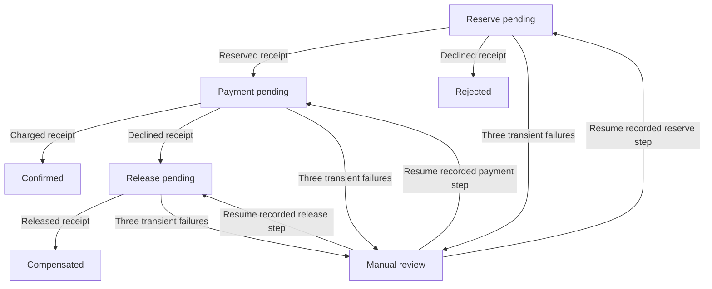

# Messaging: real broker delivery and local durability boundaries

This standalone **Java 17 / Maven** lab teaches what happens after an application delegates work to a broker. Start with the existing [LLD pub/sub design](https://lld-with-ui.vercel.app/pub-sub) for the pattern and in-process implementation. Reuse that explanation; the distinct work here is actual Kafka/RabbitMQ delivery, consumer recovery and a durable local effect.

No customer records, payments, email or cloud resources are involved. The synthetic business operation increments a ticket-activity projection in an owned temporary H2 database. The executable entry points are JUnit tests, not a web application.

## 1. Understand the three acknowledgements

Imagine the support service records that ticket `ticket-1` gained one activity. It must update its own state and eventually notify another service.

| Boundary | What success establishes | What it does not establish |
|---|---|---|
| Local source transaction | Source change and outbox record commit together | Broker received the event |
| Kafka completed send / Rabbit publisher confirm | Broker accepted under its configured acknowledgement/durability rules | A consumer committed its database work |
| Consumer database commit | Projection and inbox ID commit together | Broker stored the consumer's ACK/offset |

Failure between boundaries creates ambiguity. Repeating a send can be correct, provided the event keeps its identity and the consumer recognizes duplicates. Committing an offset or acknowledging a delivery **before** the local effect risks losing work after a crash.

A producer's idempotence setting concerns its broker protocol; it does not make a later outbox replay or arbitrary external side effect universally exactly-once. Here only the inbox and projection inside the **same H2 transaction** are deduplicated. A remote payment or email would need its own durable idempotency/reconciliation contract.

## 2. Run local durable-file tests

Requirements: JDK 17+ and Maven 3.8+. From the repository root:

```bash
mvn -B -f examples/backend-messaging/pom.xml verify
```

Expected locally: **19 tests pass; 2 real-broker tests are skipped** unless explicitly enabled. Maven also compiles the real official-client integration code. Skipping is explicit evidence of a missing broker run, not a broker pass.

The tests generate passwords at runtime, create fresh database files under JUnit temporary directories and reopen them to verify state. No credentials or database files should be committed. Reset requires no command: JUnit removes its owned temporary directory. No normal unit test starts a network service.

`DurableStoreTest` covers:

1. Crash before source commit: both source mutation and outbox insert roll back.
2. Publish then crash before the sent flag: reopening shows the same pending event, which is published again with the same ID.
3. Crash before consumer commit: both projection and inbox roll back.
4. Commit the consumer effect then crash before acknowledgement: reopening recognizes the ID and does not apply the effect twice.
5. Reuse an ID with changed business fields: reject it instead of silently accepting a different operation.
6. Send failure/ambiguous result: retain the outbox event for reconciliation/retry.
7. Additive schema metadata is readable; unsupported versions, malformed JSON, duplicate keys, trailing values and wrong required types fail.
8. Refuse remote H2 URLs, URL options and missing generated secrets.

The local publisher is an explicitly named in-process list, so those local tests prove JDBC boundary behavior, **not broker delivery**. The crash points throw after/before precisely identified commits and release/reopen JDBC connections. They are deterministic process-replacement simulations; they do not simulate sudden power loss or validate disk hardware flush guarantees.

## 3. Run the actual brokers

Pinned versions checked against primary sources on **2026-10-18**:

| Component | Pin |
|---|---|
| Kafka official Java client and JVM broker image | 4.3.1 |
| RabbitMQ official Java client | 5.37.0 |
| RabbitMQ Docker Official Image | 4.3.6 |
| H2 | 2.4.240 |
| Jackson databind | 2.21.4 |
| JUnit Jupiter | 5.12.2 |

The container commands additionally pin the registry-verified multi-platform image digests. These are reproducible selected versions, not a claim that every one is the newest release. Kafka's official quickstart documents the standalone Docker launch used here. The Java client runs on JDK 17; the broker image supplies its own runtime.

The dedicated [GitHub Actions workflow](../../.github/workflows/backend-messaging.yml) provisions both actual containers, generates RabbitMQ credentials, checks readiness within 90 seconds, runs all tests and uploads Surefire evidence. A job-level deadline caps the complete run. Its final step removes only the two containers with this job's generated names, including their anonymous volumes. It uses no hosted broker or paid resources.

If Docker is available locally, reproduce it in a fresh terminal using unused loopback ports 9092/5672:

```bash
set -euo pipefail
messaging_id="lab-$(openssl rand -hex 8)"
kafka_container="messaging-kafka-$messaging_id"
rabbit_container="messaging-rabbit-$messaging_id"
export RABBIT_USER="lab_$(openssl rand -hex 8)"
export RABBIT_PASSWORD="$(openssl rand -hex 32)"
export RABBIT_PORT=5672 KAFKA_BOOTSTRAP=127.0.0.1:9092
cleanup_messaging() {
  for name in "$kafka_container" "$rabbit_container"; do
    if docker inspect "$name" >/dev/null 2>&1; then docker rm -fv "$name"; fi
  done
}
trap cleanup_messaging EXIT

docker run -d --name "$kafka_container" -p 127.0.0.1:9092:9092 apache/kafka:4.3.1@sha256:77e3df9054047a88b520d0cc46e16696d3b22022e1d580aeccd2632df6532837
docker run -d --name "$rabbit_container" -p 127.0.0.1:5672:5672 \
  -e RABBITMQ_DEFAULT_USER="$RABBIT_USER" -e RABBITMQ_DEFAULT_PASS="$RABBIT_PASSWORD" rabbitmq:4.3.6@sha256:3e5cc23235b0eb850f604e8ace10d9a9b6d05be3e36730e53522ee9ead707a9e

messaging_ready=false
for attempt in $(seq 1 45); do
  if docker exec "$kafka_container" /opt/kafka/bin/kafka-topics.sh --bootstrap-server localhost:9092 --list >/dev/null 2>&1 \
    && docker exec "$rabbit_container" rabbitmq-diagnostics -q ping >/dev/null 2>&1; then
    messaging_ready=true
    break
  fi
  sleep 2
done
if [ "$messaging_ready" != true ]; then echo 'Broker readiness deadline exceeded' >&2; exit 1; fi
MESSAGING_BROKERS=true mvn -B -f examples/backend-messaging/pom.xml verify
```

Do not enable shell tracing: it would expose generated credentials. Authentication is required for RabbitMQ. Kafka uses plaintext without authentication on loopback only, in an isolated throwaway lab; do not expose this configuration to a network. The code refuses a non-loopback Kafka bootstrap and always connects RabbitMQ to loopback. Never point the tests at shared brokers: random topic/queue names prevent collisions, but the lab assumes permission to create/delete its own resources. Each test deletes only its own names in `finally`; the container teardown removes any residual resources after an early failure.

Expected with healthy brokers: **21 tests pass; none skipped**. Inspect the two broker test names in the uploaded report rather than reading only `BUILD SUCCESS`.

## 4. Trace Kafka's behavior

`KafkaBrokerTest` creates a two-partition event topic and a one-partition dead-letter topic with random names. The producer sends a stable `ticket-1` key sequentially, waits for each completed send, and checks the returned partition and increasing offsets. Same-key partition placement assumes the same partitioner and unchanged partition count; there is no total order across different partitions or independently coordinated producers.

The test deliberately publishes the first outbox event, crashes before marking it sent, reopens the source database and publishes the same ID again. The producer has `enable.idempotence=true`, yet this application-level replay still produces a second record. Two additional distinct events and one poison event produce five records in that partition.

The first consumer uses a named group with automatic offset commits disabled. It commits the local projection for the first event, then closes **without committing its Kafka offset**. A replacement using the same group receives that same offset again. The inbox prevents a duplicate projection update; after processing each valid record, the replacement explicitly commits `offset + 1` for that partition.

The unsupported-version record is sent to the dead-letter topic and its broker send completes **before** the source offset is committed. A crash in between can duplicate the dead-letter record, so the envelope includes source partition/offset for identification. A separate consumer verifies that a DLQ record exists. Dead-lettering is a deliberate terminal policy for this unsupported schema, not a forever-retry loop.

Finally, reopening the completed worker group yields no processed records, while a different audit group independently reads all five. The projection is 3, even though the valid event was delivered repeatedly. Group IDs identify independent subscriptions, not individual work items. This original test remains sequential. The separate [concurrent rebalance exercise](#9-watch-a-partition-move-between-concurrent-consumers) adds membership changes and actual callback/offset evidence; session expiry and prolonged processing stalls remain outside that exercise.

Requests, producer delivery, metadata blocking, polls and test duration have explicit bounds. Automatic producer retries are constrained by the delivery deadline and backoff. No unbounded application retry loop is used. Offsets and projection are separate commits; this is at-least-once processing with an idempotent local effect, not a Kafka transaction spanning H2.

## 5. Trace RabbitMQ's behavior

`RabbitBrokerTest` declares an owned durable direct exchange, work queue, binding, dead-letter exchange and dead-letter queue. The event's routing key must match the binding. A mandatory publish to a missing binding produces a return even when the publisher receives a confirm: **confirmed does not mean routed to the intended queue or consumed**.

Two persistent messages are published with confirms. A push consumer uses manual ACK and `basicQos(1)`. After it receives the first message, the test verifies that the second is withheld while one remains unacknowledged. This tests consumer prefetch; RabbitMQ's polling `basic.get` API does not enforce that prefetch window.

The first local effect commits, then the channel closes without ACK. A replacement channel receives the first message with the redelivery flag. The durable inbox recognizes the duplicate; only then does that channel ACK its own delivery tag. The second event is processed and ACKed, leaving projection value 2. Delivery tags belong to their channel; reusing an old channel's tag or acknowledging twice can close the channel.

An unsupported schema is rejected with `requeue=false`, and the test observes it in the dead-letter queue. The final DLQ inspection uses `basic.get` only to inspect the poison result, not to claim prefetch behavior. Classic-queue dead-letter forwarding is not a universal lossless transaction; broker/target failure behavior requires further tests and deployment choices.

Automatic connection recovery is deliberately disabled so closure/replacement boundaries remain visible. This lab does not prove transparent reconnect behavior. A redelivery flag is a diagnostic hint, not the durable deduplication key; use event ID and business payload binding.

## 6. Change the schema safely

`TicketEvent` has `schemaVersion: 1`, `type: TicketActivity`, `id`, `ticketId` and a positive integer `delta`. Required fields have strict types and bounded values; messages over 4,096 characters are rejected. Unknown additive metadata such as `traceId` is ignored by this reader. A new major version is rejected until a handler is deliberately added.

Do not turn a number into a string, change `delta`'s meaning or remove a required field while retaining version 1. Additive compatibility is specific to this reader policy; a reader that rejects unknown fields has a different contract. The lab is not a schema-registry deployment and does not establish compatibility for every consumer in an organization.

## 7. Predict, change and debug

1. **Predict:** A broker accepted an event, but the source process crashed before marking it sent. Will the relay send it again? **Answer:** yes. The durable pending row remains; reuse the same ID. Only marking it sent before confirmed acceptance would create a lost-delivery gap.
2. **Change:** Move the consumer ACK/offset commit before the projection commit in a local experiment. **Answer:** crashing between those steps can permanently skip the business effect. Revert the experiment; effect-first plus durable dedupe handles duplicate delivery instead.
3. **Change:** Set Rabbit prefetch to 2. **Answer:** the second delivery may arrive before the first ACK, so the existing test should fail. Prefetch bounds outstanding work; raising it changes memory, concurrency and fairness, not correctness by itself.
4. **Debug:** The API is healthy, but activity counts lag. **Evidence:** pending outbox rows, broker send/confirm errors, group offsets/lag, unacknowledged Rabbit deliveries, schema errors and DLQ growth. Locate the stuck boundary before increasing retries.
5. **Debug:** The same ID arrives with a different `delta`. **Answer:** reject and investigate the producer or identity scope. Silent dedupe would hide changed business meaning. Never generate a new ID for each retry of the same event.
6. **Interview:** Why not claim exactly-once? **Answer:** source commit, broker acceptance, consumer effect and ACK/offset are separate durability boundaries. The inbox and effect share one local transaction; arbitrary external effects and broker failover remain separate problems.

## Evidence and limits

Local verification includes eight outbox/inbox/schema tests and eleven persisted-saga tests; all three real broker tests require opt-in environment and Docker/CI evidence. The initial development environment has no Docker daemon, so this package does not claim a local actual-broker pass. Keep this distinction in release records until the dedicated workflow passes.

The example uses a single source relay and sequential consumer handlers. Its dedicated projection database gives event IDs one scope; multiple handlers or tenants need an explicit consumer/tenant identity scope in their inbox keys. Multiple relay workers need claiming/leases and per-aggregate sequencing; concurrent consumers need explicit duplicate-race handling/retry. The outbox's lexical ID ordering is deterministic teaching order, not a production causal-order guarantee. File reopen is not hardware power-loss testing. There is no multi-node replication/failover, Kafka transaction, broker-carried/distributed saga deployment, session-expiry/stalled-owner or production rebalance-load drill, schema registry, delayed retry topology, retention/replay operations or production observability deployment here. Those remain follow-up BE-04 work; this package closes the smaller broker/durability-boundary milestone.

## 8. Persisted saga: reconcile separate local commits

This incremental **BEC-40/41 / BE-04** exercise adds an orchestrated saga with
independent durable coordinator, inventory and payment files. Reuse the existing
[distributed transactions/saga lesson](../../content/dbms/09-distributed-databases-cap.md)
for the pattern. The distinct work is executable commit/restart/compensation
behavior; neither participant is a real inventory service or payment processor.
The fake payment simply increments a synthetic captured-cents counter.

Think of booking two things separately: one confirmation can arrive while the
other is uncertain. A **compensation** is a new business operation undoing a
specific earlier effect, not a magical rollback of every database or observation.
An orchestration state records which participant outcome must be reconciled next.



A review resumes only the recorded original pending stage: reserve, payment
**or release**; it cannot choose a different operation or fresh key. A manual
review state stops the automatic driver; it does not mean the business operation
has completed or its reservation has been released.

Run from the repository root:

```sh
mvn -B --no-transfer-progress -f examples/backend-messaging/pom.xml -Dtest=DurableSagaTest test
mvn -B --no-transfer-progress -f examples/backend-messaging/pom.xml verify
```

The focused command executes **eleven saga cases with no service prerequisites**.
The full local command also retains all eight earlier local cases and explicitly
skips the two broker cases. Tests generate secrets and temporary paths; no static
password, real payment, public listener, extra container or production table is used.

### Follow the actual durability boundaries

| File / owner | One local atomic transaction | Gap deliberately left visible |
|---|---|---|
| Coordinator | Persist exact request, pending stage and transition/version | Participant may commit before this stage advances |
| Fake inventory | Reserve/release stock and store exact operation receipt | Coordinator acknowledgement is separate |
| Fake payment | Capture/decline fake cents and store exact operation receipt | Inventory and coordinator are not in that transaction |

`SagaRequest` binds tenant, saga ID, SKU, quantity and cents. Stable participant
keys append `reserve`, `charge` or `release`; retry does not mint a new ID. Stored
receipts retain the full bound request. Changed fields under the same key are
rejected. Release references that exact reservation and quantity; it cannot
compensate another tenant's reservation or accidentally add stock twice.

Each `tick` performs one bounded stage rather than running a hidden retry loop.
Before mutating, it queries the participant's durable receipt. If the receipt is
present, it reconciles that outcome; if absent, it may issue the same idempotent
operation. A timeout is an **unknown result**, not a decline. Payment pending only
moves to release after a persisted **DECLINED** receipt; an already charged result
moves to confirmed, not to accidental stock release and another charge.

### Predict, change, diagnose and explain

1. **Predict:** after `start`, should stock change? No. The exact intent is durably
   pending before any participant is contacted. Reopening retains it; submitting
   changed quantity under the same saga ID is a conflict.
2. **Observe success:** stock starts at 10, reserving two leaves 8, and the fake
   capture is 1200 cents. Reopening every step and repeating a terminal tick leaves
   one reservation and one capture. Confirmation keeps the allocation; this lab
   has no separate fulfilment/shipping stage.
3. **Observe a reserve failure:** an unknown SKU produces a durable decline. The
   saga is rejected with no payment effect and no stock compensation to invent.
4. **Observe a payment decline:** reserved stock is released by one compensating
   transaction; the final stock is 10, capture is zero and state is compensated.
5. **Diagnose an ambiguous payment:** the participant commits then simulates a
   timeout. The coordinator stays payment-pending. On reopening, receipt lookup
   finds CHARGED and confirms without a second effect. Treating every timeout as
   failure would choose the wrong business transition.
6. **Diagnose interrupted compensation:** a release commits but its response is
   lost. Reopening finds the release receipt and marks compensated; stock stays
   10 rather than incorrectly becoming 12. The same applies after a real worker
   process exits at that committed boundary.
7. **Observe bounded retries:** three persisted transient lookup failures during
   release produce MANUAL_REVIEW, retaining the original release stage and held
   reservation. No terminal loop silently keeps calling dependencies. A reviewer
   supplies the current coordinator version and a short note to permit another
   reconciliation attempt. A stale review version is rejected; request/keys remain
   unchanged. The note records this local decision, not a complete audit service.
8. **Observe a real database wait:** a separate owned H2 transaction locks the
   inventory row. The participant's lock timeout fails the step while the
   coordinator preserves intent and the retry count. Three failures request
   manual review, with no stock or payment effect. Releasing an unrelated lock is
   not performed automatically by this lab.
9. **Change one thing:** sketch replacing the stable charge key on each retry with
   a random key. Predict duplicate captures after an unknown result. Keep the
   original key in the executable code; the stored-result reconciliation tests
   exist to guard this exact boundary.
10. **Interview:** “My saga persists intent and tracks separate local commits. Each
    participant binds an idempotency key to the exact operation and stores its
    outcome atomically with its effect. On unknown results I reconcile before
    choosing the next step. Compensation is a new exact operation and can itself
    fail; bounded attempts surface manual review rather than claiming success.”

### What the crash tests prove and assume

`realOwnedJvmHaltsAfterEachCommittedParticipantBoundaryAndReconciles` starts a fresh
owned child JVM for each of reserve, charge and release. The child commits the
participant, prints its boundary marker and invokes `Runtime.halt(93)` **before**
the coordinator advances. The parent requires that exact exit/marker, reopens the
files and verifies the correct final state and single effects. It terminates only
its own child on a deadline; credentials travel through the child environment,
not command arguments. These are actual process-exit/file-restart tests rather
than method mocks. The remaining timeout fixtures are explicitly simulated after
real commits, not claims of an actual network outage.

H2 uses `WRITE_DELAY=0`, a one-second lock timeout and two-second JDBC statement
limits. Those are individual operation bounds, not a hard end-to-end saga deadline.
Every JDBC connection is scoped and closed. Tests have deadlines and the teaching
driver attempts at most eight ticks; transient failures are capped at three per
pending stage, then require review. A production scheduler would additionally need
retry timing/backoff, fair work admission and observability.

Reconciliation assumes the participant can durably look up a retained receipt and
honor the same exact key after restart. If a real provider cannot provide that
contract, loses/forgets receipts, or returns an unverifiable status, the safe
business decision may require manual reconciliation. “Not found” must have a
well-defined meaning before it authorizes another side effect. This lab's receipt
lookup is local and immediately consistent; it does not prove that property for
remote providers or an eventually consistent status API.

The example has no globally atomic transaction, automatic rollback of every side
effect, real money, arbitrary refund support, saga isolation, participant failover,
message choreography, out-of-order broker command delivery or production leases
for multiple coordinators. State transitions use optimistic versions, but the
exercise assumes one active driver per saga; it does not certify a multi-worker
scheduler. File/process tests do not establish hardware power-loss guarantees or
a backup/restore policy. Keep those BE-04 gaps visible.

## 9. Watch a partition move between concurrent consumers

**Evidence status:** the new `KafkaRebalanceBrokerTest` compiles locally, but its
actual broker scenario requires the pinned Kafka CI run. A local run without
`MESSAGING_BROKERS=true` deliberately skips all three broker tests; it does not
establish rebalance/recovery behavior. The dedicated workflow refuses any skipped
`KafkaBrokerTest`, `KafkaRebalanceBrokerTest` or `RabbitBrokerTest` and requires the
new actual `target/rebalance-evidence.json` receipt before passing.

Use the existing broker startup and Maven commands above. This adds no new image,
service, dependency or app. It uses the selected Kafka **4.3.1** client/broker,
Java 17 and the **classic** group protocol with an eager `RangeAssignor`. This
explicit selection makes revocation visible; it is not a comparison with the newer
consumer protocol or cooperative assignment behavior.

### Predict the ownership and durable state

A partition belongs to one active member of this consumer group at a time. A
second member can share work from a two-partition topic. Group membership itself
does not commit either your database transaction or Kafka's recovery position.

| Step | Expected broker ownership | Required observation |
|---|---|---|
| Start A alone | A owns both partitions | Actual assigned callback and Admin description with one member/two partitions |
| Start B while A keeps polling | A and B each own one | Actual nonempty A revocation, distinct owner threads, stable two-member broker description and disjoint assignments |
| Send one event per actual owner | Both consume and commit their local effects | Actual deliveries on each thread; A commits its next offset, B deliberately does not |
| Unsubscribe/close B | A eventually owns both | Actual B revocation, A reassignment, stable one-member broker description |
| A reads B's uncommitted record | Replay has original partition, offset and event ID | Independent B/A delivery observations, inbox reports no second business effect, A commits the next offset |
| Send a new marker | A can continue useful work | New effect accepted; final broker offsets and projection totals match |

The test chooses B's **observed assigned partition** after the broker is stable.
It does not assume that a client name or random member ID always receives a
particular partition. Events use explicit observed partitions for this experiment;
key-based routing/order is demonstrated separately by the existing Kafka test.

Both consumers have separate live polling loops on two executor threads. Each
`KafkaConsumer` is constructed, subscribed, polled, committed, unsubscribed and
closed only by its owner thread. The sole cross-thread client operation is
`wakeup()` for bounded shutdown. Admin calls independently inspect actual group
membership and committed offsets; local assignment fields alone are insufficient.

### Separate the effect from its recovery offset

Automatic commits are disabled. A processes the event, commits its H2 inbox and
projection, then commits Kafka `record.offset() + 1`. B commits the same local
transaction but intentionally omits that Kafka commit and pauses its assigned
partition while continuing to poll and maintain membership.

Before B leaves, the actual broker offset listing must contain A's completed
position and **no committed entry for B's partition**. The test also checks B's
observed delivery against the producer's returned partition/offset, verifies the
local effect is 1, and records that evidence independently from A's later replay.

B then unsubscribes and closes gracefully **without committing the held offset**.
A receives the partition and the exact original record. `DurableStore.consume`
returns `false` because that event's inbox row already committed, and reopening
the H2 file still gives projection 1. A then commits its offset and accepts a fresh
marker, giving projection 2 for that ticket and 1 for the other ticket.

This is an actual concurrent membership handoff with a **controlled graceful
member departure at the effect-before-offset boundary**. It is not an OS process
crash, heartbeat/session expiry, broker failure, multi-node failover or H2/Kafka
atomic transaction. Three original events plus one redelivery do not establish
production throughput, realistic load behavior or universally exactly-once effects.

### Revoke only what is completed

The listener keeps a per-partition map of offsets whose local effect finished.
`onPartitionsRevoked` commits only entries belonging to revoked partitions and
then clears ownership state. It never commits a fetched-but-unfinished position.
B has no completed offset entry for its deliberately held event, so its listener
cannot accidentally acknowledge that effect-before-offset gap during departure.

`onPartitionsLost` deliberately does not commit; ownership may already have moved.
That defensive branch is present, but this graceful departure scenario does not
claim to execute the lost/session-expiry path. All listeners execute on the
consumer's owner thread. There is no asynchronous database handler continuing
writes after its partition has been revoked in this experiment.

### Inspect, change, debug and explain

The version 1 receipt includes actual broker cluster ID, resolved client/runtime
versions, stable group descriptions, assignments, callback phases/generations,
original and replay deliveries, before/after committed offsets, projection checks
and owned resource cleanup. It contains only original synthetic event IDs and
metadata, no credentials, raw customer payloads or database paths. CI artifacts
also retain the existing Surefire test reports. No fabricated local broker receipt
is committed while actual execution is unavailable.

**Debug:** if the local projection is already updated but a record repeats, compare
the event ID, original partition/offset, current group assignment, committed Kafka
position and durable inbox. Repetition alone does not prove the producer duplicated
the message: a consumer may have finished its database effect before saving its
recovery position. If a callback does not fire, verify subscription/group protocol
and membership changes before adding arbitrary sleeps or retries.

**Change one thing:** commit B's completed offset before it leaves and predict why
A should no longer replay that record. The fixed regression intentionally expects
the uncommitted gap, so change the prediction and evidence checks together. Or add
a third member to a two-partition topic and predict that one member can be idle;
that is a distinct extension, not claimed by the two-member evidence.

**Interview answer:** “I observed a real two-member consumer group with disjoint
partition ownership and actual revocation/reassignment callbacks. One member
committed a local effect but not its Kafka offset, then left. The survivor replayed
the same partition/offset/event ID; the transactional inbox prevented a second
local effect, and the survivor committed its next position and processed new work.
I only acknowledge completed partition work on graceful revocation. This is
at-least-once delivery with a deduplicated local transaction, not a distributed
exactly-once guarantee.”

All work is bounded: at most two owner threads, one record per poll, 90-second
owner lifetimes, 25-second observation waits, finite broker requests/commits/joins,
64 callback/16 delivery entries per member and a 32KiB evidence cap. Each run creates
one random topic and group. Cleanup closes both owners, deletes only those exact
names and requires them absent from broker metadata; the workflow then removes
only its owned broker containers. Physical disk erasure, foreign topics and shared
broker administration are outside this lab.

## Primary sources checked

- [Apache Kafka quickstart](https://kafka.apache.org/quickstart/) documents the official Docker setup; [Kafka producer configuration](https://kafka.apache.org/43/configuration/producer-configs/) explains idempotence, ordering and delivery deadlines.
- [Kafka consumer configuration](https://kafka.apache.org/43/configuration/consumer-configs/) defines group/offset settings and automatic commit behavior.
- [RabbitMQ Java client releases](https://github.com/rabbitmq/rabbitmq-java-client/releases/tag/v5.37.0) and [Docker Official Image version inputs](https://github.com/docker-library/rabbitmq/blob/master/versions.json) establish the selected pins.
- [RabbitMQ confirms and acknowledgements](https://www.rabbitmq.com/docs/confirms) distinguishes publishing, consuming and prefetch; [Java client recovery behavior](https://www.rabbitmq.com/client-libraries/java-api-guide) explains why applications must still handle redeliveries.

The saga follow-up uses the [orchestration/compensation pattern](https://microservices.io/patterns/data/saga.html) and [H2 JDBC/file behavior](https://h2database.github.io/html/features.html). Its participant business rules and failure fixtures are original synthetic examples.
- [Kafka 4.3 rebalance listeners](https://kafka.apache.org/43/javadoc/org/apache/kafka/clients/consumer/ConsumerRebalanceListener.html): assignment, graceful revocation and lost-ownership distinctions.
- [Kafka 4.3 consumer API](https://kafka.apache.org/43/javadoc/org/apache/kafka/clients/consumer/KafkaConsumer.html): owner-thread safety, polling and committed recovery position.
