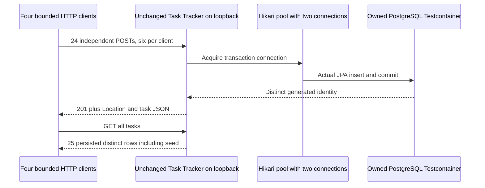

# Test the existing API against actual PostgreSQL, then explain a load result

A passing unit test answers a narrow question. It does not prove that an HTTP request reaches PostgreSQL, that concurrent requests keep their rows, or that a low p95 means users had a good experience. This lab makes those distinctions visible using the **existing Task Tracker application unchanged**, actual PostgreSQL through Testcontainers, and a small bounded HTTP workload.

This is the BE-07 practical exercise for BEC-73–77. Start with the [Spring testing lesson](../../content/java-spring/11-spring-testing-production.md) and [Task Tracker walkthrough](../java-spring/task-tracker/README.md). No prior load-tool or Docker knowledge is assumed; [Docker fundamentals](../../content/devops/01-docker-fundamentals.md) explains the dependency container. The test is a learning exercise, not a reusable production load generator.

## 1. Predict which claim each check can establish

A **unit test** isolates behavior so a failure is easy to locate. An **integration test** checks components together. An **API test** crosses HTTP and checks the response contract. A **load test** observes a stated workload over time. These are scopes, not an automatic ranking of quality.

| Risk | Existing owner or executable check | What a passing result proves | What it does not prove |
| --- | --- | --- | --- |
| Blank/long task titles | Existing `TaskServiceTest` | Pure business validation boundaries | Serialization, routing or database constraints |
| MVC request mapping/security | Existing `TaskApiTest` and security suites | The selected MVC/security behavior | A real network, actual PostgreSQL or the entire deployment |
| HTTP client misunderstands create responses | `LabGuardTest.actualStubChecksConsumerContract...` | Consumer accepts valid stub shape and rejects wrong ID type | That the real provider implements the contract |
| Stub drifts from provider | `ActualPostgresHttpTest.realProviderMatchesConsumerContract...` | The same create-contract check passes against real Task Tracker HTTP | Every possible API schema/evolution or a published consumer-driven contract registry |
| Database differs from H2 | Actual PostgreSQL test | The existing two Flyway migrations, Hibernate validation and a real PostgreSQL NOT NULL rejection | Every PostgreSQL feature, all migrations, or production data volume |
| Concurrent writes lose records | Four real HTTP clients, 24 creates | All tested independent inserts produce distinct IDs and 25 total persisted rows, including the seed | Concurrent updates to the same row, which have separate existing version/optimistic-lock exercises |
| Application state is accidentally only in RAM | Close/reopen the application context against the same owned PostgreSQL | Committed completion and row count survive application-context restart | Process-kill recovery, power failure or database failover |
| Async test sometimes reads too early | Causally controlled local async test | The early read is wrong under a forced valid schedule; awaiting completion fixes the dependency | A measured probability of random flakes or every possible data race |
| Latency report hides errors | Known-sample statistics test plus actual three-phase workload | Every attempted request, including non-2xx/transport errors, enters counts, buckets and percentiles | External requests the closed-loop generator never started |
| A bad release needs rollback | [Existing kind recovery lab](../backend-operations/README.md#4-diagnose-the-bad-revision-before-undoing-it) | Actual CI there observes a failed revision and recovery to its good template | This package independently deploying Kubernetes |
| Rollback meets a changed schema | [Existing persistence lab](../backend-persistence/README.md#4-expand-backfill-contractand-compatible-rollback) | Actual compatibility/transactional DDL rollback boundaries documented there | Application rollback automatically undoing persisted business writes |

Use the existing rollback/migration exercises after this one. Rebuilding them here would create two sources of truth. Existing broker/cache integration lives in `../backend-messaging` and `../backend-data-services`; this lab's real dependency is PostgreSQL, not a fake broker or cache.

## 2. Run the right command

Requirements: Java 17, Maven, Python 3.12+, and a **local Docker daemon** for the actual suite. Testcontainers is a Java library that starts an isolated dependency container, waits for readiness, gives the test its actual mapped address, and stops it. You do not create a database or enter credentials manually.

From the repository root:

```sh
python3 -m unittest discover -s examples/backend-testing -p 'test_verify.py' -v
python3 examples/backend-testing/verify.py
```

The verifier runs `mvn clean verify`, requires all **eight Java tests** (four local guard/contract/async tests and four actual PostgreSQL/HTTP tests) with **zero skips**, validates the actual report and preserves only sanitized success evidence under `examples/backend-testing/target/evidence/`.

Without Docker, run the genuinely local checks:

```sh
mvn -B -f examples/backend-testing/pom.xml -Dtest=LabGuardTest verify
python3 -m unittest discover -s examples/backend-testing -p 'test_verify.py' -v
```

Those commands execute four real local tests and six Python evidence guards. They compile the actual integration suite but **do not run it**. They cannot establish actual PostgreSQL, concurrent-provider, restart or workload evidence. Missing Docker is a failure of the full command, never an automatic skip or an H2 replacement. The [dedicated workflow](../../.github/workflows/backend-testing.yml) requires the full command on Docker-capable CI.

For direct failure diagnosis on your own machine:

```sh
mvn -B -f examples/backend-testing/pom.xml clean verify
```

The module imports the sibling Task Tracker's main Java source and resources through Maven's source/resource paths. It writes only to **this module's** ignored `target/`, does not edit/copy the service into a second codebase, and does not run or replace Task Tracker's original test suite. Its existing CI remains that suite's owner. The verifier checks that original sources remain unchanged and framework/Java/telemetry versions match. This separate module is intentionally not a packaged deployable service.

Versioned dependency: Testcontainers **2.0.5**, PostgreSQL **16.15** image `sha256:ca0bd484cb98bf4b24eb1010e73fb3fcbd6714d240fbc1a10eea5b7dbecb641d`, matching the existing persistence workflow. Spring Boot **4.1.1**, Java **17**. The PostgreSQL image is pinned; Testcontainers' own helper-image defaults are library-managed, not an all-images provenance claim. Upgrading the pin/framework requires rerunning the real suite.

## 3. Trace the real request, then the concurrent invariant



Before running, predict:

1. Why can four HTTP clients still make progress with a pool of two? The other requests wait briefly for a connection; a connection is released after the transaction, rather than permanently attached to one client.
2. Why use distinct synthetic titles? Checking only `201` could miss duplicate identities or lost rows. The test checks returned identities **and** the provider's final rows.
3. Why do invalid title, missing task and malformed completion have different expected responses? Validation rejects bad input with 400; a syntactically valid request for a missing object is 404. The 400 Problem Details contract must not reveal stacks or credentials.
4. Why is this not an exactly-once/idempotency test? These are distinct creates. Retrying a POST can create another row; persistent duplicate-submit behavior has its own existing exercises.
5. What survives the restart? PostgreSQL remains running while the application context and its connection pool close and reopen. Flyway revalidates the same schema, and the committed row/completion remain. This is not a child-process crash test.

The persistence-only profile deliberately reuses Task Tracker's existing unauthenticated teaching mode. The server binds `127.0.0.1` and holds only generated synthetic tasks. This lab tests HTTP/database behavior; its results do not replace the existing security/PKCE/JWT checks. Do not expose this profile publicly.

## 4. Interpret the bounded workload correctly

The three measured phases issue **60 total read attempts**. Four warm-up reads happen first and are excluded from all measured counts/times. The generator uses a **closed loop**: each worker waits for its current response before starting the next request. It has no independent external arrival schedule or unbounded queue.

| Phase | Request cap | Client concurrency | Dependency condition | Required functional observation |
| --- | --- | --- | --- | --- |
| Healthy | 24 | 2 | Both pool connections available | 24 successful HTTP reads |
| Controlled starvation | 12 | 4 | Test deliberately holds both actual pool connections | 12 actual HTTP 500 responses, active connections = 2, observed waiters |
| Recovered | 24 | 2 | Held connections closed | 24 successful reads and unchanged row count |

Each request caps the response at **32 KiB** and has a **four-second full-response wait**. Each phase has a **20-second deadline**, at most four worker threads and no retries. The owned HTTP connection timeout is two seconds. Hikari acquisition timeout is 500 ms. Bounds are failure guards, not target p95 service-level objectives. A deadline/test failure does not get silently converted to a successful partial report.

The starvation phase makes the first bottleneck explicit: the **test owns both database connections**, real request threads wait, and Hikari raises actual acquisition timeouts. It is a causal dependency-exhaustion experiment. It does **not** establish that four normal clients saturate PostgreSQL or that this pool size is appropriate in production. More threads would not release the two held connections.

The report contains:

- All attempts, successes, errors and status/transport outcome counts. Fast errors are still errors.
- **Nearest-rank p50/p95** over every measured attempt, including failures. Sort latencies, select rank `ceil(p × count)`, then convert nanoseconds to milliseconds.
- Explicit noncumulative latency bucket counts whose sum equals the attempt count. There is no hidden omission of slow/error cases.
- Throughput as **attempts / phase wall-clock seconds**. Adding individual request durations would double-count concurrent time and is not throughput.
- Actual sampled Hikari active/waiting counts, JVM heap use, JVM thread count and process CPU-time delta when supported. Sampling every five milliseconds can miss short peaks. CPU/heap/thread observations include the HTTP generator and sampler because service and test run in one JVM; they are not isolated service/container CPU measurements. Unsupported process CPU is `null`, not zero.

Do not compare these tiny phases as production capacity benchmarks. Healthy/recovery phases contain startup/JIT/GC/host noise despite warm-up. A low p95 can coexist with 100% fast failures. Closed-loop clients also reduce offered traffic while responses slow down, so the run cannot reveal latencies of external arrivals it never started (**coordinated omission**). Use an appropriate external open-loop tool, realistic datasets, longer windows, resource isolation, repeatability and explicit SLOs for a real capacity question.

### Predict → change → debug

1. Predict what changes if the pool grows to three while the fault still holds only two connections. Then change only that setting. The current 12-error assertion should fail because the injected fault no longer exhausts the pool. That is the experiment catching a changed premise.
2. Restore pool size two. Release the held connections before the fault phase. Predict success and explain why the reported bottleneck should disappear.
3. Change consumer stub ID from a number to a string. The consumer contract rejects it even though JSON is valid. Keep the valid real-provider check: a green stub alone is not provider evidence.
4. In `LoadSummary`'s small known-sample test, calculate p95 before running it. If you remove failed attempts, which count, bucket total and percentile assertions catch the mistake?
5. Diagnose a failed full run in this order: Docker/readiness → Flyway schema validation → HTTP contract → row invariant → pool fault observation → recovery → owned cleanup. Do not increase timeouts before locating the failing boundary.

## 5. Reproduce a flaky test without hoping it flakes

A common broken test submits asynchronous work and immediately asserts its result. It sometimes passes because the worker happened to finish first.

`badAsyncReadHasTwoCausallyForcedSchedulesAndWaitingForCompletionFixesIt` makes the ordering deterministic:

1. The worker announces it has entered, then blocks on an owned latch.
2. The test reads the shared result. It must still be absent: submitting work is not completing work. The passing causal test explicitly **expects this counterexample**; it does not leave CI intentionally red.
3. The test releases the worker and waits for its completion future with a bounded timeout.
4. It then verifies the result is ready. The old read would have passed under this later valid schedule.

There are no arbitrary sleeps, date/clock guesses or retries-until-green. The fix expresses the actual happens-before dependency: **observe completion, then assert the result**. Timeouts only prevent hung tests; they do not choose the ordering. A forced counterexample proves the bug is possible, not how often the scheduler naturally produces it.

## 6. Own the cleanup and promote evidence honestly

The Testcontainers instance owns its generated-password PostgreSQL container and anonymous volume; reuse is disabled. Its mapped database port binds IPv4 loopback. Task Tracker owns an ephemeral loopback HTTP listener and a pool of two. Closing its application context closes those resources. Try/finally and `@AfterAll` stop the exact owned resources, while Testcontainers' resource reaper provides normal JVM-exit cleanup. The code never prunes Docker, stops a user's database or kills unrelated JVMs.

The verifier clears inherited application/Java/Testcontainers injection settings, rejects remote Docker endpoints, caps Maven output/time and stops only its own build process group. Cleanup follows the owned process group even if Maven has already exited while a fork still holds stdout open. An actual owned-process regression creates that condition, observes the parent terminal, then verifies the surviving SIGTERM-resistant child cannot remain executable after cleanup. Raw build/application output is consumed privately rather than uploaded. Failure diagnostics extract only allowlisted suite/method names and numeric counts from bounded JUnit XML; exception text, system output, JDBC details and credentials are never copied into those diagnostics. Public success reports contain no passwords, JDBC locations, request bodies or task titles. Only the two sanitized JSON reports are workflow artifacts; the full suite must execute with no skipped tests before verification is published.

Local evidence from 2026-10-18: all four Java guard/stub/async/statistics tests and all six Python evidence guards passed; the actual suite compiled. Docker is unavailable in the authoring WSL environment. **Actual PostgreSQL/load/restart evidence is pending the dedicated CI run** until its no-skip verification artifact exists. A future green CI run proves only the scenarios and workload stated here, not every BE-07/production requirement.

## 7. Answer the interview from your observations

**“How would you choose a test strategy?”** Start with a failure you need to prevent. Use cheap pure tests for input/business boundaries, focused framework tests for mapping/security, and a smaller set of real dependencies/HTTP tests for database and network contracts. Name the invariant and explain which layer would miss it. Do not substitute an H2 pass for PostgreSQL semantics.

**“Your stub passes but production breaks. Why?”** A stub proves the consumer against its configured example. It can drift from the provider. Here the same shape check runs against both a deliberately broken stub and the actual provider; wider compatibility needs versioned schemas/consumer-provider checks and a release policy, not just more stub cases.

**“How do you fix a flaky asynchronous test?”** Reproduce the unsafe ordering with explicit coordination, identify the missing dependency, then synchronize on the real completion condition. Raising a sleep or retrying the test changes probability, not correctness. Keep bounded waits so failures remain diagnosable.

**“What does p95 mean?”** In this finite run it is the nearest-rank latency of all attempts, errors included; 95% of those samples fall at or below it. It does not mean 95% of users were successful. Report counts, errors, offered workload, measurement window and resource signals together.

**“Would adding threads fix this incident?”** No: the controlled fault holds every connection. More waiting threads do not create connections or end transactions. First locate the exhausted resource and its owner, recover it, then choose pool/concurrency bounds from dependency capacity and measurements.

**“When is rollback unsafe?”** A previous application artifact may not understand a newly contracted schema, and rolling back code does not reverse business writes. Work through the linked existing migration and bad-revision recovery labs; verify readiness and functional results after recovery rather than assuming an undo command means recovered service.

## Primary references

- [Testcontainers PostgreSQL module](https://java.testcontainers.org/modules/databases/postgres/): actual dependency and driver requirements.
- [Testcontainers lifecycle and readiness](https://java.testcontainers.org/features/startup_and_waits/): readiness is separate from container-process startup.
- [JUnit user guide](https://docs.junit.org/current/user-guide/): test lifecycle and assertions.
- [HikariCP configuration](https://github.com/brettwooldridge/HikariCP#configuration-knobs-baby): pool size/acquisition timeout meanings.
- [Java Future contract](https://docs.oracle.com/en/java/javase/17/docs/api/java.base/java/util/concurrent/Future.html): completion waits and memory-consistency boundary.
