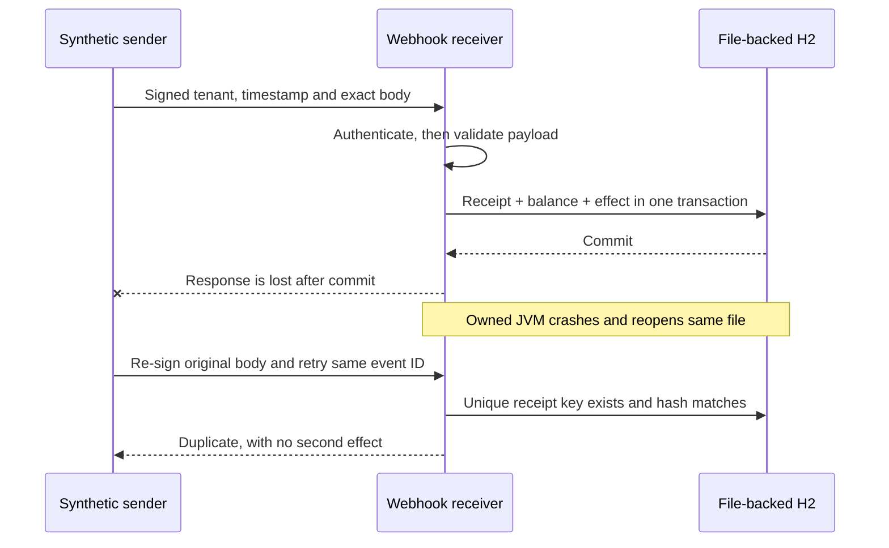

# Signed webhooks: authenticate, commit once, recover an uncertain response

A **webhook** is another service calling your HTTP endpoint when an event occurs. Imagine a payment provider saying “credit this synthetic account by 7 minor units.” It can deliver the same notification repeatedly when the response gets lost. A signature answers **who possesses the signing secret and whether these bytes changed**. It does not stop an authentic event being delivered twice. Your database must enforce the event's business effect separately.

This BE-06 lab adds that missing inbound integration to the learning path. It reuses [Spring REST API design](../../content/java-spring/08-spring-rest-api-design.md), [Spring Security](../../content/java-spring/09-spring-security.md) and [transactions](../../content/dbms/06-transactions-acid.md). The [OAuth/PKCE lab](../backend-identity/README.md) already demonstrates token issuance and resource authorization; a provider-to-server webhook uses a different authentication contract.

Requirements: Java **17+**, Maven and Python **3.12+**. The example pins Spring Boot **4.1.1**, with managed Jackson **3.1.5**, Tomcat **11.0.24** and H2 **2.4.240**, verified in the packaged JAR on October 18, 2026. No Docker, external account, paid API, cloud deployment or committed credential is needed.

```sh
python3 examples/backend-webhooks/verify.py
```

Five Python guards separately verify environment/privacy isolation and owned-process failure cleanup. The verifier runs all eight Java tests, packages the actual application, starts four successive owned JVMs and drives actual HTTP. It generates five independent runtime secrets, obtains an OS-assigned loopback port through a private readiness file and uses an owned file-backed H2 database. It removes the processes and temporary database after success or failure. Only the sanitized evidence remains under `target/evidence/`.

For the harness guards and a focused Java run:

```sh
python3 -m unittest discover -s examples/backend-webhooks -p 'test_verify.py' -v
mvn -B -f examples/backend-webhooks/pom.xml verify
```

That command alone does **not** establish packaged HTTP, a stalled body, a lost response or an actual process crash. The [dedicated workflow](../../.github/workflows/backend-webhooks.yml) runs the full verifier and refuses missing HTTP/recovery evidence or skipped Java tests.

## 1. Predict the trust boundaries

There are two fixed tenants: `tenant-a` and `tenant-b`. The verifier acts as their fictional sender and as a separate observer. An authenticated sender cannot choose a third tenant or use tenant A's signature at tenant B's route. The observer secret grants only read access to this lab's aggregate balances/receipt/effect counts; it is not a signing secret.

| Value | Who creates it? | What does the receiver trust? |
| --- | --- | --- |
| Tenant route | A configured sender targets `/webhooks/tenant-a` or `/webhooks/tenant-b` | A fixed local registration plus a signature bound to that exact tenant |
| Key ID | Sender chooses `old` or `new` | Only the receiver's configured key for that tenant; it never fetches a key from the request |
| Timestamp | Sender records current Unix seconds | Exactly ten decimal digits within the receiver's ±60-second window |
| Event ID | Sender identifies one notification | A durable key scoped to the authenticated tenant and bound to the original raw body hash |
| Amount | Sender includes integer `amountMinor` | Parsed only after authentication; integer 1–1000 and `type=credit` |

The exact signature input is:

```text
timestamp + "\n" + tenant + "\n" + exact raw request-body bytes
```

The receiver calculates **HMAC-SHA-256** with the registered 256-bit key, decodes a lowercase 64-character hex signature and compares the fixed-size MACs using `MessageDigest.isEqual`. Each request has exactly one `X-Key-Id`, `X-Timestamp` and `X-Signature`. Duplicate authentication headers are rejected. Query strings, compressed bodies and non-JSON media types are not accepted by this instructional contract.

**Predict:** Would adding one space after a valid JSON document matter? It still parses as the same object, but its bytes change. Keeping the old signature causes **401**. Signing the changed bytes is authentic, but reusing an already committed event ID with that changed body causes **409**. These are different failures.

**Observe:** Actual HTTP checks exercise both cases, a cross-tenant route substitution, stale/future timestamps, duplicate headers and unauthenticated observation. No JSON reserialization occurs before signature verification.

**Change:** In your disposable copy, remove the tenant from the MAC input. The cross-tenant checks should still reject tenant A's key because tenants have different keys, but you have weakened the protocol binding. Keeping both key isolation and explicit message-context binding makes later key-management mistakes less dangerous. Do not remove either control to make a test pass.

## 2. Distinguish replay protection from duplicate effects

A fresh timestamp limits replay of an intercepted signed request. It does not make deliveries within that window unique. A legitimate sender can also sign the exact body again with a fresh timestamp when retrying. Deduplication therefore uses `(authenticated tenant, event ID)` and the SHA-256 hash of the **raw body**, not the timestamp/signature.

The local transaction performs these operations:

1. Insert a receipt with tenant, event ID, body hash and schema version. Its composite primary key is the concurrency arbiter.
2. Increment the tenant's synthetic balance.
3. Insert the corresponding effect row, with the same composite key and a foreign key to the receipt.
4. Commit all three changes together.



The first delivery returns **202 `applied`**. A same-key/same-body duplicate returns **200 `duplicate`** after comparing the stored body hash. A same-key/changed-body delivery returns **409 `event_conflict`** and cannot alter the balance. On a duplicate-key race, the losing transaction rolls back before it reads the committed receipt. Other database failures are not relabelled as duplicates.

**Observe:** Four actual HTTP clients start together. Exactly one returns `applied`, three return `duplicate`, and the observer sees one extra receipt, one extra effect and exactly 11 additional minor units. The Java concurrency test independently exercises the same real file-backed transaction boundary. An injected pre-commit failure rolls back the receipt, effect and balance together, permitting a later valid delivery.

**Change:** Move the balance update outside the receipt's transaction in a disposable copy. Predict the duplicate or lost-update failure before running the tests. Restore the single transaction afterward.

**Interview answer:** “I authenticate the sender and scope the idempotency key to that identity. A database uniqueness constraint arbitrates concurrent delivery, and the receipt and effect commit together. I retain the original payload binding and outcome. This proves one local effect for that retained receipt, not universal exactly-once execution of external payments or emails.”

## 3. Lose the response after a real commit, then crash and reopen

A timeout tells the sender that it did not receive a usable response. It does not tell it whether the receiver committed.

The verifier starts the packaged app with a bounded, explicitly named lab-only response delay. After a successful commit the receiver writes a fixed `committed` signal into its private temporary directory, then delays its response. The client observes that signal **and the changed aggregate balance before its actual HTTP read timeout**. It then kills only its owned JVM with an actual process kill and reopens the same H2 file in a new JVM.

A re-signed, byte-identical delivery returns `duplicate`. The observer proves that the event has exactly one receipt/effect and that the balance increased once. A changed body still returns `event_conflict` after restart. H2 uses `WRITE_DELAY=0`; this is an actual process-crash/reopen experiment, not a guarantee about machine power loss, disk failure, replicas or another database engine.

The commit signal and response delay are controlled by environment variables used only by the local verifier. There is no HTTP header that lets a sender turn on a fault, obtain the observer secret or select a file path. The signal contains no event ID, amount, signature or secret. If writing that signal fails **after** the database committed, the response can be **503 even though the effect exists**. Reconcile the persisted receipt; do not interpret every 5xx as proof of rollback.

**Debug:** Check the authenticated tenant, event ID, exact body identity and durable receipt first. Never invent a new event ID merely because the first response timed out. Reconstructing JSON with different whitespace also changes this contract's body binding; the sender must retain the exact original delivery bytes.

## 4. Rotate a secret without confusing it with JWT rotation

Tenant A initially accepts independent `old` and `new` HMAC keys; tenant B has its own key. The verifier sends valid events under both tenant A keys, restarts with `LAB_ACCEPT_OLD=false`, then proves that the retired old key returns **401** while the active new key still works. A receipt originally created under the old key remains readable through a retry signed with the active key: event identity is separate from key ID.

This is a tested overlap/retirement procedure using generated runtime configuration. It does not deploy a secret store, distribute keys among production replicas or erase key bytes from JVM memory. Retiring a key immediately rejects new deliveries signed with it, including legitimate delayed retries, so coordinate the overlap window with the sender's retry policy. A compromised key may require immediate retirement and incident reconciliation instead of a long overlap.

Passwords and signing/observer keys are generated with Python's `secrets` module for every run, passed through the owned child process environment and never stored in tracked defaults or printed. The verifier refuses to publish server logs containing any known runtime secret, signature or complete signed body. Environment delivery is an instructional injection mechanism, not proof of production secret lifecycle controls.

**Interview answer:** “I introduce a new key ID, accept the minimum necessary overlap, move the sender, observe old-key use, then retire it. I test both overlap and rejection. Idempotent receipts survive rotation. I still need production distribution, access control, revocation ownership and audit procedures.”

## 5. Make schema compatibility explicit

Version 1 requires `schemaVersion`, `eventId`, `type` and integer `amountMinor`. Version 2 preserves their meaning and adds optional bounded `deliveryHint` text. The current receiver accepts both. The same minor-unit amount means the same thing in either version; no automatic string-to-integer or amount-unit conversion occurs.

Unknown versions, duplicate JSON fields, trailing JSON, malformed UTF-8, wrong types, negative/out-of-range amounts, unsupported event types and unexpected fields return **422 `payload_invalid`**. A reader configured with `LAB_MAX_SCHEMA=1` intentionally rejects version 2; that is an explicit compatibility limit rather than a silent interpretation. The Java tests exercise this older-reader rejection, while actual HTTP proves the current receiver accepts both payload versions and rejects version 3.

**Predict:** Can you retry the same event as version 2 after version 1 committed? The semantic intent may match, but its exact body hash differs, so **409** is correct under this protocol. Evolve schemas for new events and preserve original bytes for retries. If a production protocol wants canonical semantic binding instead, define and version its normalization rules deliberately.

## 6. Bound failure and diagnose the first broken layer

| Boundary | Actual configured limit | Failure / evidence |
| --- | --- | --- |
| Listener | IPv4 loopback, OS-assigned port; startup validates both settings | Private readiness file; no exposure to an external interface |
| HTTP resources | Eight servlet workers, 32 connections, accept backlog eight, 4-KiB headers, two-second keep-alive | Finite instructional budgets, not measured production capacity |
| Request admission | 256 requests per process lifetime; at most 16 admitted asynchronous bodies | **429** and `Retry-After: 1`; no unbounded application queue |
| Body | At most 4096 bytes; depth four, string length 256, number length 12 | **413** for known-length and actual chunked oversize; strict parser tests |
| Body collection | 2.5-second asynchronous body timer plus monotonic checks while reading; container idle-read setting five seconds | Actual incomplete-body check observes application **408** before the container's idle timeout |
| Database | Four processing permits with immediate rejection, 750-ms lock timeout and one-second query timeout per prepared statement | **429** on saturation or fixed **503** for database failure; transaction rollback/receipt reconciliation |
| Fault experiment | Optional response delay 0–5000 ms, disabled normally | Actual client timeout after commit; no automatic retry of a write |
| Harness | 180-second build, 60-second startup per JVM, bounded HTTP/process termination | Failure removes success report and tears down owned runtime |

These are **separate budgets**, not a hard end-to-end deadline. In particular, `AsyncContext.setTimeout(8000)` after body collection is not a guarantee that it can preempt a synchronized database callback or its injected response delay. The callback holds its exchange lock, SQL has its own per-operation limits, and the timeout callback cannot complete that exchange until the lock releases. No hard real-time, global retry budget or capacity guarantee follows.

Responses contain fixed result codes, with `Cache-Control: no-store` and no stack trace, SQL message, raw request, token or key. Transport errors can still be generated by Tomcat before the servlet handles a request; the application does not claim every malformed HTTP byte receives its JSON envelope.

Debug in this order:

1. **401:** check exactly one header of each required kind, tenant/key registration, original bytes, clock and whether the key was retired. Do not log the secret or signature to diagnose it.
2. **413 / 415 / 422:** distinguish transport/body policy from authenticated schema meaning. Do not widen limits or coerce bad values merely to accept input.
3. **409:** compare retained event identity and original body hash. A changed delivery needs investigation, not a blind retry with another ID.
4. **429:** inspect the local admission/processing limit. Back off within the sender's deadline; adding more retries can make saturation worse.
5. **Timeout / 503:** reconcile the durable receipt. Confirm whether commit occurred before deciding to redeliver.

### Integration failure and correction

The first actual slow-body run returned **HTTP 500 after 2.088 seconds**: the container's original two-second idle read budget fired before the application's 2.5-second body timer. The application-level failure contract was therefore unproven despite passing Java tests. The owned listener's idle timeout is now five seconds so the application timer can finish first. The packaged incomplete-body regression requires actual **408 within four seconds**; the sanitized dated report records the measured passing result. This fixes budget ordering, not every possible network/proxy timeout interaction.

## 7. Evidence and what still needs production design

The [dated local report](evidence/2026-10-18-local.json) records actual Java and HTTP outcomes, observations and cleanup. Runtime test reports go to `target/surefire-reports/`; CI retains them and sanitized verifier artifacts. The report's JAR hash identifies that local build, not a reproducible-build or signed-release guarantee.

This deliberately small credit ledger is not a payment processor. The receipt, effect and balance are in **one H2 transaction**; a remote side effect would need its own durable idempotency/reconciliation boundary or outbox/saga design. Receipt retention/expiry, disk quotas, multi-instance key rollout, distributed rate limits, production TLS, provider-specific header formats and audit/incident ownership remain explicit deployment design questions. Do not copy these teaching HMAC headers into a real provider integration unless they match that provider's documented protocol.

Required-scope contribution: BE-06; BEC-08 API compatibility, BEC-36 idempotency, BEC-70 security controls and BEC-72 runtime secret overlap/retirement. This does not close every OWASP control, generic SSRF, API gateway, WebSocket or cloud-secret requirement.

Primary contracts checked October 18, 2026: [Java 17 `Mac`](https://docs.oracle.com/en/java/javase/17/docs/api/java.base/javax/crypto/Mac.html), [Java 17 `MessageDigest.isEqual`](https://docs.oracle.com/en/java/javase/17/docs/api/java.base/java/security/MessageDigest.html#isEqual(byte%5B%5D,byte%5B%5D)), [Spring Boot servlet registration](https://docs.spring.io/spring-boot/api/java/org/springframework/boot/web/servlet/ServletRegistrationBean.html), [Tomcat HTTP connector timeouts](https://tomcat.apache.org/tomcat-11.0-doc/config/http.html), [H2 transaction support](https://h2database.com/html/advanced.html#transaction_isolation) and [H2 `WRITE_DELAY`](https://h2database.com/html/commands.html#set_write_delay). These are version-labelled references, not a permanent “latest” claim.
